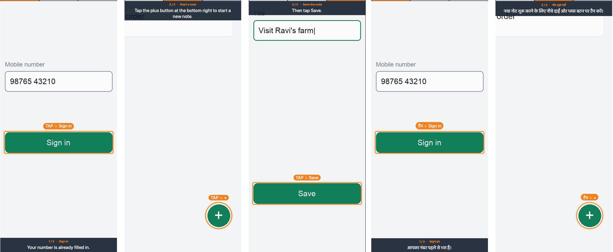
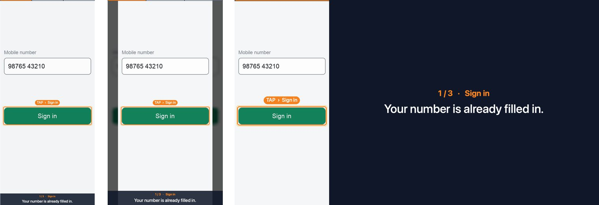

# Building Narrated Screen Tutorials

A skill for Claude Code that turns a screen recording of any app into a finished video manual: every tap frozen, highlighted and named by a voice, with captions, subtitles and one edition per language.

You give Claude a recording and say who the video is for. Claude acts as a **director** with a **crew of nine specialist agents**, builds the first language, and asks for your approval at each stage before going further.



*Frames from the included demo (a made-up app), in English and Hindi.*

## What makes it different

**The voice and the picture cannot drift apart.** Each tap gets its own short line. The video freezes on that tap for exactly as long as the line takes, with a box, a label and a fingertip dot on the control. Captions, subtitles and checks all read the same timeline.

**Each language gets its own timing.** A Hindi line that runs longer than the English one simply holds its tap longer. No language is rushed and none has dead air.

**It is made like a film.** A director runs a crew, each with a written brief and a standard to meet:

| Crew member | Job |
|---|---|
| Colourist | Sets the crop and makes the colour match the device |
| Tap spotter | Finds every tap, its exact moment and its button |
| Frame designer | Chooses the layout, colours and highlight style |
| Screenwriter | Writes the steps and one line per tap |
| Voice director | Picks the voice and pace, fixes pronunciations |
| Editor | Builds the video, sound and subtitles |
| Quality inspector | Judges the finished file independently |
| Translator | Carries the approved script into one more language |
| Delivery | Makes the small share copy and the thumbnail |

**You approve before it goes further.** There are three checkpoints: the look and the list of steps, the script, and the finished first-language video. Other languages come only after that, one at a time, each with its own approval. The builder itself refuses a second language until the first is approved, and refuses to overwrite a video you have approved.

**The app gets the whole picture.** No decorative frame around a small phone.



*Left to right: `native` (the video is the screen's own shape), `portrait` (a strict 1080×1920 file), `landscape` (1920×1080 with a text panel, for laptops and projectors).*

## Features

**Picture**
- Correct colour from HDR recordings. Phone mirrors often record in HDR, which looks dull and grey when converted the usual way; the engine detects this and converts it properly.
- A gentle zoom on each tap, larger for smaller controls.
- Highlight box with a label chip, or a spotlight that dims the rest of the screen.
- A fingertip dot that presses the control as the freeze ends, and an optional soft click.
- Blur for private details in the recording.
- A thin progress bar and a step title when each step begins.
- The result of each tap stays on screen at normal speed before typing and loading are sped up.

**Sound and text**
- Natural voices through edge-tts, including Indian English, Hindi, Telugu, Tamil, Kannada, Malayalam, Marathi, Bengali and Gujarati.
- Pronunciation fixes that change what the voice says without changing the caption.
- Captions that appear only while someone is speaking and move out of the way of the control being tapped.
- Correct rendering of Indic and other complex scripts.
- A subtitle track and chapter markers inside the video, so viewers can jump to a step, plus a separate `.srt` file and a chapters list.
- Optional background music.

**Building and checking**
- One command builds an edition; one file (`project.json`) describes the whole tutorial.
- A tap finder that suggests tap moments from screen changes, and contact sheets that show every tap box on its frame.
- Automatic checks on the finished file: colour tags, length, loudness, subtitles, and that every tap really shows its box and caption.
- A spreadsheet export so a native speaker can review and correct the lines.
- A small share copy under a size limit, a thumbnail of the finished result, and a check report beside each video.
- A written guide (web page and PDF) and a click-through web page from the same project.
- One step can be re-recorded on its own when the app changes.
- A brand kit: logo, colours and font set once and reused.

**Craft**
- Writing and pacing rules drawn from a study of eleven widely watched tutorials: name the control at the touch, say what the viewer needs first, cover the common mistakes, end on the result. See [`references/craft-notes.md`](references/craft-notes.md).

## Install

```bash
git clone https://github.com/kammakrishnakiran123-stack/building-narrated-screen-tutorials ~/.claude/skills/building-narrated-screen-tutorials
```

Claude Code loads the skill automatically. You also need:

- `ffmpeg`
- Python 3 with `numpy` and `Pillow`
- `edge-tts` (`python3 -m pip install edge-tts`)
- On macOS, the Xcode command-line tools, for the best text rendering

## Use it

In Claude Code, describe the job in your own words:

> Make a tutorial video from this screen recording: `~/Desktop/add-customer.mp4`. It's for new field staff watching on their phones. English first.

Claude will ask what it needs to know, show you sample frames and the step list, then the script, then the finished video. To add a language later:

> Now make the Hindi edition.

Tips for a good recording:
- Record the task once, slowly, without mistakes you do not want shown.
- Turn on the phone's "show touches" option if it has one.
- Use sample data that looks like real work (a plausible name and amount, not "Test 123"), or tell Claude what to blur.

## Try the engine without a recording

```bash
cd examples/demo
python3 make_demo_clip.py
python3 ../../scripts/build.py project.json look
python3 ../../scripts/build.py project.json lang en
```

This draws a short recording of a made-up app, shows sample frames in `work/`, and builds the English video in `output/v1/`.

## What you get

For each language, in the output folder:

| File | What it is |
|---|---|
| `<name>_<Language>.mp4` | The tutorial, with a subtitle track inside |
| `<name>_<Language>.srt` | Subtitles as a separate file |
| `<name>_<Language>_chapters.txt` | Step titles with times, ready to paste into a description |
| `<name>_<Language>_small.mp4` | A smaller copy for chat apps, when the full one is over the limit |
| `<name>_<Language>.jpg` | A thumbnail |

## What is inside

| Path | Purpose |
|---|---|
| `SKILL.md` | The director's playbook: crew, approval checkpoints, commands |
| `agents/` | One brief per crew member |
| `scripts/` | The engine: build, tap finder, tap sheets, checks, delivery, review spreadsheet |
| `references/project-format.md` | Every setting in `project.json` |
| `references/how-it-works.md` | How the engine works and why, with a table of symptoms and fixes |
| `references/craft-notes.md` | What widely watched tutorials do, and what to keep |
| `examples/demo/` | A made-up app recording and its project file |

## Limits

- The voices are synthetic. Listen to a new language before sharing it widely, and have a native speaker read the translation.
- The tap finder suggests; it does not decide. Someone has to confirm each tap on the contact sheets.
- Text rendering for Indic scripts is best on macOS. On Linux and Windows, Pillow needs `libraqm`.
- HDR conversion is proven for PQ recordings (the common kind). HLG is supported but not yet proven on a real recording.
- `edge-tts` needs an internet connection.

## Contact

Questions or suggestions: making.pontoon8d@icloud.com
